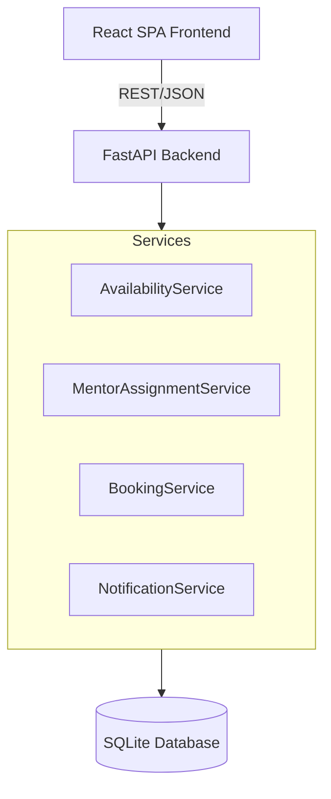
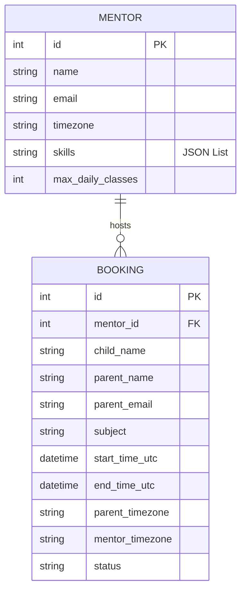
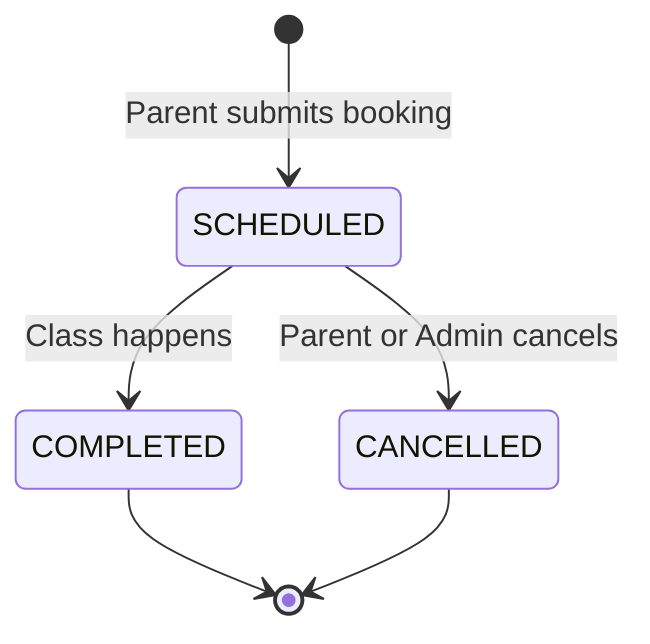

# TrialFlow Architecture Specification

## 1. Architecture Diagram



## 2. Database ER Diagram



## 3. Database Schema

### Table: `mentors`
- `id`: Integer, Primary Key
- `name`: String, Not Null
- `email`: String, Unique, Not Null
- `timezone`: String (IANA), Not Null (e.g., "America/New_York")
- `skills`: JSON, Not Null (e.g., `["Math", "Coding"]`)
- `max_daily_classes`: Integer, Not Null (e.g., 2 or 3)

### Table: `bookings`
- `id`: Integer, Primary Key
- `mentor_id`: Integer, Foreign Key (`mentors.id`), Indexed
- `parent_name`: String, Not Null
- `parent_email`: String, Not Null
- `child_name`: String, Not Null
- `subject`: String, Not Null
- `start_time_utc`: DateTime (UTC), Not Null, Indexed
- `end_time_utc`: DateTime (UTC), Not Null, Indexed
- `parent_timezone`: String (IANA), Not Null
- `mentor_timezone`: String (IANA), Not Null
- `status`: String, Not Null (Default: "SCHEDULED")

## 4. REST API Contract

### `GET /api/availability`
- **Query Params**: `date` (YYYY-MM-DD), `timezone` (IANA string), `subject` (string)
- **Response**: List of available start times mapped to the requested local timezone.
```json
{
  "date": "2026-09-28",
  "timezone": "America/New_York",
  "slots": [
    {"start": "2026-09-28T09:00:00Z", "displayTime": "9:00 AM"}
  ]
}
```

### `POST /api/bookings`
- **Body**: 
```json
{
  "parent": {
    "name": "Jane Doe",
    "email": "jane@example.com",
    "childName": "Jimmy",
    "childAge": 10,
    "timezone": "America/New_York"
  },
  "subject": "Coding",
  "startTime": "2026-09-28T09:00:00Z"
}
```
- **Response**: `201 Created` with Booking ID, Mentor Details, and Meeting URL.

### `GET /api/bookings/{id}`
- **Response**: Booking details including dynamically generated join link and localized timestamps.

## 5. Booking State Machine


*(Keeping it simple, avoiding complex states like RESCHEDULED unless required by scope expansion).*

## 6. Mentor Assignment Algorithm

When a parent requests a booking at `startTime`, the `MentorAssignmentService` executes:

1. **Filtering**:
   - Filter mentors who have the requested `subject` in their `skills`.
   - Convert `startTime` to mentor's local timezone. Ensure `startTime` falls within standard working hours (e.g., 9 AM to 5 PM mentor-local time).
   - Check if mentor already has a booking overlapping with `[startTime, startTime + 45m]`.
   - **Daily Limit Check**: Retrieve all bookings for the mentor on the *mentor's local calendar day* of `startTime`. Ensure `count < mentor.max_daily_classes`.

2. **Scoring/Sorting (Fair Load Balancing)**:
   - Sort eligible mentors by:
     1. Fewest bookings on that specific day.
     2. Fewest bookings total (all-time).
     3. Random or ID-based fallback.

3. **Allocation**:
   - The top mentor from the sorted list is selected and returned for the booking transaction.

## 7. Timezone / DST Strategy

- **Storage**: All temporal data (`start_time_utc`, `end_time_utc`) is stored strictly as naive/UTC-enforced timestamps in SQLite, meaning no offsets are stored in the column natively.
- **Timezone Strings**: We store the IANA timezone names (e.g., `America/Los_Angeles`) for both the parent and the mentor.
- **DST Safety**: 
  - We do *not* store fixed offsets (like `-05:00`). 
  - To calculate "Mentor's Calendar Day" (essential for daily limits), we project the UTC timestamp into the mentor's IANA timezone at runtime using Python's `zoneinfo` or `pytz`. This automatically handles DST boundaries correctly depending on the specific date of the booking.
- **UI Rendering**: The API returns UTC ISO strings. The frontend uses `date-fns-tz` to convert and format the time for the parent's specific timezone in the UI.

## 8. Concurrency Strategy

- **Issue**: Two parents simultaneously request the exact same time slot, and the system might assign the same mentor to both, exceeding their capacity or creating a double-booking.
- **Solution (Pessimistic Locking + Constraints)**:
  - Inside the booking transaction, we query the `Mentor` row with `with_for_update()` (row-level lock) if supported by the DB, or we wrap the assignment and booking insertion in a single serializable SQL transaction.
  - Before committing the insert, the `BookingService` performs a final `COUNT()` of overlapping bookings for that mentor. If `count > 0`, it aborts and rolls back, throwing a `409 Conflict`.
  - Since we use SQLite for this demo, transactions natively lock the database, inherently avoiding race conditions but limiting horizontal write scaling (acceptable for this scope).

## 9. Frontend Component Architecture

- **Routing**: `react-router-dom`
  - `/` -> Landing Page
  - `/book` -> Booking Wizard (Parent Details -> Timezone -> Slot Selection)
  - `/confirmation/:id` -> Success Page & Details
  - `/admin` -> Platform metrics
- **State**: React Hook Form for wizard data. TanStack Query (React Query) for fetching slots and handling loading/error states for availability.
- **UI Library**: `shadcn/ui` + Tailwind CSS.
- **Component Splits**:
  - `BookingFlow.tsx`: Manages the wizard state (Step 1, Step 2, Step 3).
  - `SlotPicker.tsx`: Handles date iteration and rendering available time buttons.

## 10. Test Strategy

1. **Unit Tests (Pytest)**:
   - `test_availability_service.py`: Verify slots are generated within 9-5 local boundaries, respecting DST rules.
   - `test_assignment_service.py`: Verify the round-robin logic selects the mentor with the lowest class count.
2. **Integration Tests (Pytest + FastAPI TestClient)**:
   - Post a booking and verify the `201` response.
   - Post two overlapping bookings and verify the second one gets a different mentor or fails with `409` if no mentors are left.
3. **Timezone Edge Cases**:
   - Mock timestamps across DST transition dates (e.g., November fallback in US) and ensure the daily limit resets at the correct local midnight.
